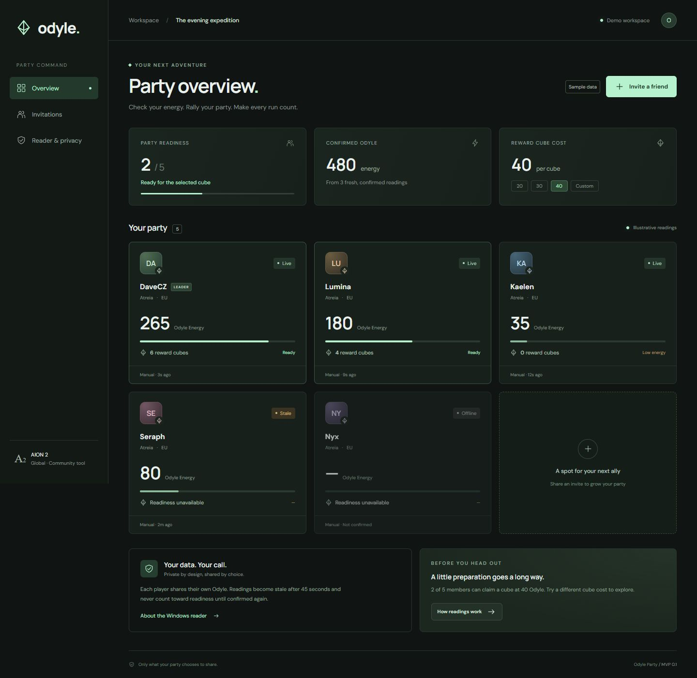

# Odyle Party Dashboard

A polished, private AION 2 party dashboard backed by **PocketBase**. Vanilla JavaScript + Vite; no React or separate ASP.NET service. The companion desktop publisher lives in [odyle-windows](https://github.com/oldbear24/odyle-windows).



## What works

- Create a room without a game account. Receive a room-scoped leader credential.
- Generate separate player and read-only viewer invites, valid for 30 minutes.
- Join from the Windows app or a browser; explicitly consent before publishing.
- Realtime PocketBase SSE updates, adjustable cube costs, member removal and invite rotation.
- Confirmed zero remains zero. Unconfirmed readings show a dash. Stale/offline readings cannot make a player ready.
- Stop sharing clears the reading. Reconnect, resume and character changes require new confirmation.
- Rooms expire after 24 hours without activity; expired records are removed every five minutes.
- Tests cover five independent publishers, room isolation, viewer permissions, live delivery, revocation and replay rejection.

**Current MVP: manual readings only.** No packet capture, memory reading, game modification or gameplay automation. The API rejects packet reports until a verified Global adapter is implemented. Sample data is available only through the explicitly labeled demo workspace.

## Run locally

Install Node.js 22 and Git. From this repository:

```powershell
npm ci
npm run backend:install
npm run backend
```

In a second terminal:

```powershell
npm run dev
```

Open `http://127.0.0.1:5173`. Create a room and share the **player** code with the Windows app. Its server URL is `http://127.0.0.1:8090`.

The installer downloads PocketBase **0.40.5** from its official release and verifies the release checksum. Database migrations apply automatically on startup. No superuser credential is needed by the app. Create an operator account through PocketBase's local setup screen if you need its management UI; never put an operator token in the frontend.

You can also serve the production frontend with PocketBase:

```powershell
npm run build
npm run backend
```

Then open `http://127.0.0.1:8090`. For a separate frontend host, copy `.env.example` to `.env` and set `VITE_POCKETBASE_URL` to the HTTPS backend URL **before building**.

## Verify

```powershell
npm test
npm run test:integration
npm run build
```

Integration tests start an isolated PocketBase on port 18090, use a temporary database, and clean it up afterward. They require the installed binary. Normal app data stays in ignored `backend/pb_data/`.

## Deploy

See [deployment](docs/deployment.md), [API contract](docs/api.md) and [privacy](docs/privacy.md). GitHub Actions checks both JavaScript and the real PocketBase backend, then uploads the static build. No production deployment happens automatically.

## Repository layout

```text
src/                    browser UI and reading display logic
backend/pb_migrations/  collections, permissions and default settings
backend/pb_hooks/       authenticated application routes and expiry job
scripts/                verified PocketBase installer and local runner
tests/                  correctness, authorization and realtime integration
```

Fonts are loaded from Google Fonts with system fallbacks. The dashboard has no analytics. For a fully self-contained deployment, self-host the fonts or remove the CSS import.

PocketBase references used for this implementation: [migrations](https://pocketbase.io/docs/js-migrations/), [custom routing](https://pocketbase.io/docs/js-routing/), [auth tokens](https://pocketbase.io/docs/js-records/), [realtime](https://pocketbase.io/docs/js-realtime/).
